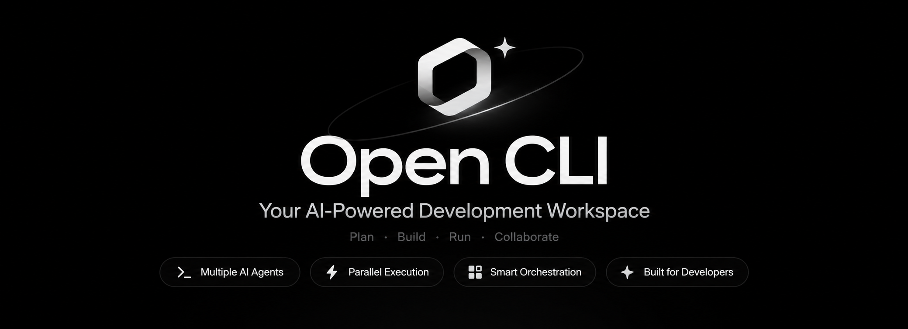

## Features

- **Authentication**: Email/password with Clerk integration (optional)
- **Desktop App**: Tauri v2 with native terminal (PTY), embedded browser, window controls
- **Agent CLI**: Custom agents, unique `Alt + letter` shortcuts, project picker, unified launcher dropdown
- **Social**: Fixed webviews for WhatsApp, Discord, GitHub, Zoom, Telegram, Gmail, and Microsoft.com; collapsible group, persistent tabs, and drag-reorderable menu with saved order
- **Dashboard**: Users, Tasks, Settings (Profile, Account, Appearance, Notifications, Display, Privacy, Uninstall)
- **Global Search**: Command palette with keyboard shortcuts (⌘K / Ctrl+K)
- **Theming**: Light/Dark/System with persistence
- **Layout**: Configurable sidebar (inset/floating/sidebar), collapsible states
- **RTL Support**: Full right-to-left language support
- **Accessibility**: ARIA attributes, keyboard navigation, screen reader announcements
- **Internationalization**: Font selection, direction (LTR/RTL)

## Tech Stack

| Layer | Technology |
|-------|------------|
| UI | React 19, TailwindCSS v4, Radix UI |
| Routing | TanStack Router (file-based) |
| State | Zustand, TanStack Query |
| Desktop | Tauri v2 (Rust) |
| Build | Vite 8, TypeScript 6 |
| Testing | Vitest + Playwright (browser) |
| Linting | ESLint 10, Prettier |

## Project Structure

```
src/
├── components/
│   ├── ui/           # Radix UI wrappers (27 components)
│   ├── layout/       # Header, Sidebar, Main, AuthenticatedHeader
│   └── data-table/   # Table toolbar, pagination, bulk actions
├── context/          # Theme, Layout, Font, Direction, Search providers
├── features/
│   ├── auth/         # Sign-in, Sign-up, OTP, Forgot password
│   ├── users/        # User management with table, dialogs
│   ├── tasks/        # Task management with table, dialogs
│   ├── settings/     # Profile, Account, Appearance, Notifications, Display, Privacy, Uninstall
│   ├── terminal/     # Multi-tab PTY terminal (desktop only)
│   ├── chats/        # Chat interface
│   └── errors/       # Error boundaries (401, 403, 404, 500, 503)
├── hooks/            # useTableUrlState, useMobile, useDialogState
├── lib/              # Utilities, cookies, platform detection, PTY, browser
├── routes/           # File-based routes (TanStack Router)
├── stores/           # Zustand stores (auth)
└── styles/           # Global CSS, theme variables
```

## Run Locally

### Prerequisites

- Node.js 22+
- pnpm 10+
- Rust 1.80+ (for Tauri desktop)

### Web Development

```bash
# Install dependencies
pnpm install

# Start dev server
pnpm run dev
```

### Desktop Development

```bash
#setup environtment
$env:Path = "$env:USERPROFILE\.cargo\bin;$env:Path"

# Start Tauri dev (includes web dev server)
pnpm run desktop:dev

# Build desktop app + installer NSIS
pnpm run desktop:build

# Build installer NSIS ke release
pnpm run desktop:build:release

# Clean build lalu build installer NSIS
pnpm run desktop:build:release:clean

# Bersihkan artifact build saja
pnpm run build:clean
```

### Installer Release

`pnpm run desktop:build:release` menghasilkan satu file installer:

```text
release/
└── opencli-<version>.exe
```

`<version>` berasal dari `package.json`. Installer NSIS otomatis mengunduh dan memasang WebView2 runtime jika belum tersedia, sehingga memerlukan internet saat instalasi pada mesin tanpa WebView2. Data aplikasi tetap dibuat di `%USERPROFILE%\.config\opencli`, bukan di folder instalasi.

### Version

Ubah versi hanya di `package.json`. Saat `pnpm run version:sync`, `pnpm run dev`, atau build dijalankan, versi tersebut otomatis disamakan ke:

- `src-tauri/tauri.conf.json`
- `src-tauri/Cargo.toml`
- `src-tauri/Cargo.lock`
- halaman About
- nama file installer

### Testing

```bash
# Run tests headless
pnpm run test

# Run tests with UI
pnpm run test:ui

# Run tests with coverage
pnpm run test:coverage
```

### Linting & Type Check

```bash
# Lint
pnpm run lint

# Type check + Vite build
pnpm run build
```

## Desktop Features (Tauri)

- **Terminal**: Multi-tab PTY terminal with grid layout, drag-to-resize panes
- **Agent CLI**: Unified launcher dropdown, custom agents, project picker, `Alt + letter` shortcuts
- **Embedded Browser**: Multi-tab native WebView2 workspace with local profile
- **Window Controls**: Minimize, maximize, close with manual drag
- **System Theme**: Syncs with OS dark/light mode
- **Privacy**: Clear browser data, session-only browser mode, uninstall with confirmation

## Data & Privacy

Semua data desktop disimpan lokal per akun Windows:

| Build | Root data |
|-------|-----------|
| Production | `%USERPROFILE%\.config\opencli` |
| Development (`pnpm run desktop:dev`) | `%USERPROFILE%\.config\opencli-dev` |

Profil browser WebView2 ada di `<root>\EBWebView`. Data tersebut berisi cookie, local storage, dan sesi website. Tidak ada data yang ikut ke repo dan tidak ada sinkronisasi otomatis antar laptop. Gunakan `Settings → Privacy` untuk menghapus data browser atau mengaktifkan sesi browser privat. `Settings → Uninstall` menghapus seluruh root data produksi setelah konfirmasi `UNINSTALL`.

## Configuration

### Environment Variables

Copy `.env.example` to `.env`:

```bash
cp .env.example .env
```

| Variable | Description |
|----------|-------------|
| `VITE_CLERK_PUBLISHABLE_KEY` | Clerk authentication (optional) |

### Clerk Authentication (Optional)

The `/clerk` routes provide a complete Clerk integration. To enable:

1. Create a Clerk application at [clerk.com](https://clerk.com)
2. Add `VITE_CLERK_PUBLISHABLE_KEY` to `.env`
3. Navigate to `/clerk` to use Clerk auth

Without the key, the Clerk routes show setup instructions. The main app uses a simple mock auth at `/sign-in`.

## Scripts

| Command | Description |
|---------|-------------|
| `pnpm run dev` | Start web dev server |
| `pnpm run desktop:dev` | Start Tauri dev |
| `pnpm run desktop:build` | Build desktop app + NSIS installer |
| `pnpm run version:sync` | Samakan versi dari `package.json` ke semua file |
| `pnpm run desktop:build:release` | Build installer `release/opencli-<version>.exe` |
| `pnpm run desktop:build:release:clean` | Clean build, lalu build installer NSIS |
| `pnpm run build:clean` | Hapus artifact build |
| `pnpm run build` | Type check + Vite build |
| `pnpm run lint` | ESLint |
| `pnpm run test` | Vitest headless |
| `pnpm run test:ui` | Vitest UI |
| `pnpm run test:coverage` | Coverage report |

## License

MIT License - see [LICENSE](LICENSE) for details.

## Credits

Built with [shadcn/ui](https://ui.shadcn.com), [TanStack](https://tanstack.com), [Tauri](https://tauri.app), [Radix UI](https://radix-ui.com), [TailwindCSS](https://tailwindcss.com), [Lucide Icons](https://lucide.dev).